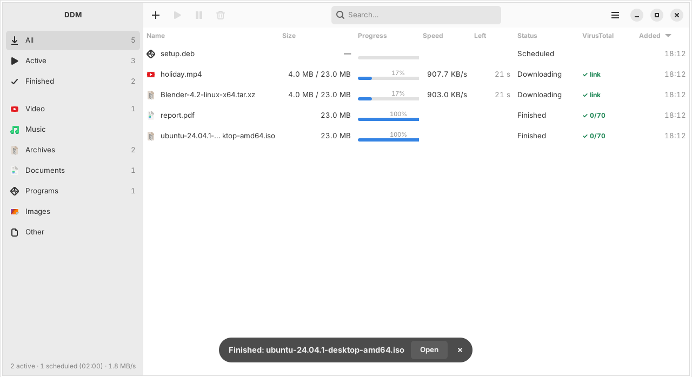
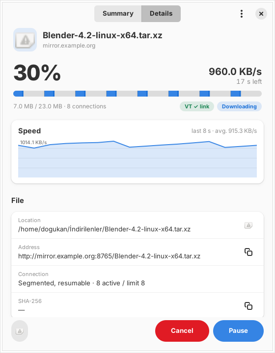
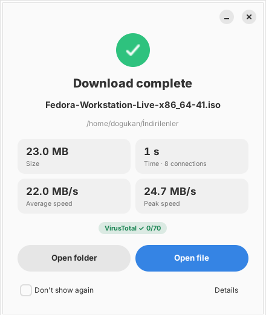
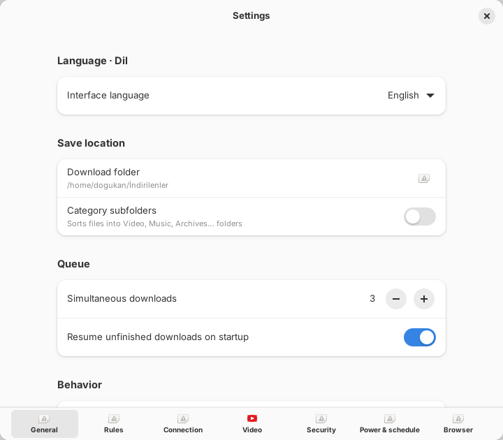
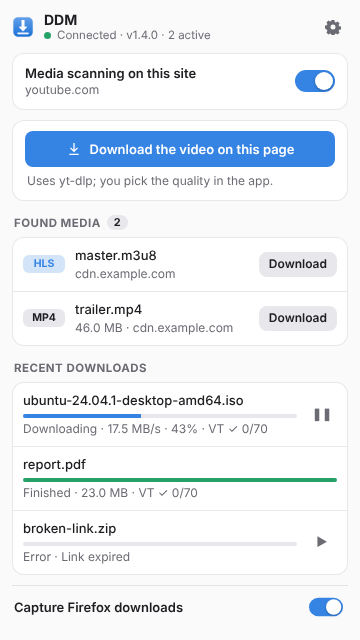

# DoDownloadManager (DDM)

**English** · [Türkçe](README.tr.md)

A multi-connection download manager for Ubuntu. Native GTK4/libadwaita UI, IDM-style dynamic segmenting, bonding of several internet connections, video downloads via yt-dlp, VirusTotal checks and a Firefox extension.

The interface is available in **English** and **Turkish**. It follows your system language, and you can switch it in Settings ▸ General ▸ Language.



| Details | Finished | Settings |
|---|---|---|
|  |  |  |

## Features

**Download engine**
- Splits a file into 1–16 parallel HTTP `Range` connections (8 by default).
- **Dynamic segmenting:** a connection that finishes takes over half of the largest remaining segment, so the download never waits on one slow tail connection.
- Segment state is saved to SQLite every 2 seconds. Downloads resume after a restart. If the `ETag` or `Last-Modified` changes, the download starts over.
- Backs off automatically on 429/503 and ramps back up once the server calms down. `Retry-After` is honored.
- Falls back to a single connection when the server ignores `Range`, including servers that start ignoring it mid-download.
- Global speed limit (token bucket), concurrent download limit and an ordered queue.
- Disk space is reserved up front (`posix_fallocate`), so a full disk is reported before the download starts.

**Multiple adapters (connection bonding)**
- Spreads the connections of large files across several internet links, for example home Wi-Fi plus USB tethering from a phone.
- Each connection is bound to its network interface with `SO_BINDTODEVICE`. No root is needed on Linux 5.7+.
- Faster links get more segments. If a link drops or stalls for 6 seconds, its segments move to the remaining links and the download continues.
- Enable it in Settings ▸ Connection ▸ *Multiple adapters*. Choose which links to use and the minimum file size (50 MB by default). Metered links are marked.
- The detail window shows the live speed of each link.
- Limits: Wi-Fi and Ethernet on the same router give no gain, because both share one internet line. Not used for servers without `Range` support or for yt-dlp videos.

**Expired link refresh**
- If the server answers 401/403/404/410 after part of the file has arrived, the download is marked "link expired" and the partial file is kept.
- Open the download page again and click download in the browser: DDM recognizes the same file by name and size and offers to resume. The same offer appears in the add dialog. You can also paste a new link via right-click ▸ *Refresh link…*.
- Before resuming, DDM checks that the new link serves the same file: the size must match and sample bytes from an already downloaded region must be identical. Otherwise the partial file is kept and you are warned.

**Power and scheduling**
- The computer does not go to sleep while downloads are running (the screen can still blank).
- Main menu ▸ *When all finish* ▸ suspend or power off when everything finishes, with a 60-second cancelable countdown.
- **Scheduler:** downloads marked as scheduled only run inside a time window (02:00–07:00 by default; windows over midnight work).
- **Metered connections:** downloads are held or throttled on metered connections such as phone tethering. A notification button lets you override it.

**Rules and post-processing**


- Pick a folder by extension, site or text in the file name, e.g. `deb, rpm` → `~/Packages`.
- Per rule: extract archives automatically (zip, tar.gz/xz/bz2; 7z, rar and zst need the `7zip` package), delete the archive after extracting, open the file or the extracted folder when done.
- Archives with a single top-level folder are not nested again. Paths that would escape the target folder are rejected.
- Nothing is extracted or opened if VirusTotal flags the file or the checksum does not match.

**Checksum verification**
- When a download finishes, DDM looks for `SHA256SUMS`, `file.sha256` and similar files next to it and verifies the file automatically. Ubuntu ISOs and most GitHub releases provide them.

**Video**
- YouTube, Vimeo, X, Instagram and every other site yt-dlp supports, plus plain `.m3u8`/`.mpd` streams.
- Quality picker with the real resolutions of the page, MP4/MKV, audio only (MP3/M4A).
- Optionally saves each video into its own folder (`Title/Title.mp4`).
- HLS/DASH fragments are downloaded in parallel and merged with ffmpeg. Browser cookies are passed to yt-dlp for videos that need a login.
- yt-dlp can be updated with one click. YouTube needs a JavaScript runtime: DDM installs [deno](https://deno.com) for it (Settings ▸ Video), or uses an existing deno ≥ 2.3 / Node ≥ 22.
- DRM-protected content cannot be downloaded.

**Interface**
- English and Turkish, following the system language by default. Switch in Settings ▸ General ▸ Language; the app restarts and downloads resume where they left off.
- Categories, search and a sortable table.
- Detail window with a compact **summary** view and a **details** view (speed graph, location, URL, SHA-256, VirusTotal results, per-connection progress).
- A finish window with size, time, average and peak speed, the speed graph, VirusTotal and checksum results and *open file* / *open folder* buttons.
- Notifications are withdrawn from the GNOME list once you've seen them.
- `Ctrl+V` paste, drag and drop, clipboard link suggestions. Keeps running in the background after the window is closed.
- **Top bar icon** (AppIndicator, built into Ubuntu): a progress ring with percentage and speed, a menu with per-download progress bars and recent downloads. Other GNOME distributions need the "AppIndicator and KStatusNotifierItem Support" extension.

  

**VirusTotal**
- Add a free VirusTotal API key in Settings ▸ Security and every download is checked. The file itself is never uploaded unless you ask.
- **On start:** the URL (or the domain, if the URL is unknown) is looked up. If it is flagged, the download is paused and you are asked what to do.
- **While downloading:** if the server sends a hash header (`Repr-Digest`, `Digest`, `x-goog-hash`, `x-amz-checksum-sha256`), it is looked up before the file finishes.
- **On finish:** the SHA-256 is computed and looked up. Results appear in the list: ✓ 0/70, ⚠ 2/70, ✕ 15/70 or "? unknown".
- **Unknown files** can be uploaded via right-click (with confirmation, 650 MB limit). Uploaded files are shared with VirusTotal partners, so do not upload personal documents.
- **Free quota:** 4 requests/minute, 500/day. One download uses at most 3 requests.

**Firefox extension**



- Hands downloads started in Firefox (filtered by extension and size) over to DDM, together with cookies, Referer and User-Agent. If DDM is not running, Firefox keeps the download.
- Follows Firefox's language (English or Turkish).
- **Early capture (1.0.2):** downloads are intercepted as soon as the response headers arrive (`webRequest`), so Firefox never starts downloading them. Small files are no longer missed. The older cancel-after-start method remains as a fallback.
- **Per-site media scanning**, only on sites where you enable it: detects video/audio files and HLS/DASH streams and shows a count on the toolbar badge.
- "Download" button over videos, context menu entries and a popup with status, found media and recent downloads.

## Installation

Requires Ubuntu 24.04 or newer (GTK 4.12+, libadwaita 1.5+).

### .deb package (recommended)

Download `dodownloadmanager_<version>_all.deb` from the [latest release](https://github.com/ddogukann/DoDownloadManager/releases/latest) and open it, or run:

```bash
sudo apt install ./dodownloadmanager_*_all.deb
```

Then open Settings ▸ Video and install yt-dlp and the JavaScript runtime (deno) with one click. They are kept in your home folder so DDM can update them itself.

DDM tells you when a new version is out (Settings ▸ General ▸ *Check for new versions*, or main menu ▸ *Check for updates*). Installing the new .deb over the old one keeps your settings and downloads. Remove it with `sudo apt remove dodownloadmanager`.

If you installed DDM with `install.sh` before, run `./uninstall.sh` first; your settings and history are kept.

### From source

```bash
git clone https://github.com/ddogukann/DoDownloadManager.git
cd DoDownloadManager
./install.sh
```

The script:
- installs missing packages with `apt`: `python3-gi`, `python3-gi-cairo`, `gir1.2-gtk-4.0`, `gir1.2-adw-1`, `python3-requests`, `ffmpeg`;
- copies the app to `~/.local/share/ddm/app` and creates the `~/.local/bin/ddm` launcher and a desktop entry;
- downloads the latest yt-dlp, and deno if no suitable JavaScript runtime is installed;
- packages the extension as `~/.local/share/ddm/extension/ddm-firefox.xpi`.

Options: `--no-apt`, `--no-ytdlp`. Uninstall with `./uninstall.sh` (`--purge` also removes settings and history; downloaded files are never touched).

## Firefox extension

Release Firefox only installs extensions signed by Mozilla. Three options:

1. **Sign it (recommended, free):** create an [AMO API key](https://addons.mozilla.org/developers/addon/api/key/), then
   ```bash
   export AMO_JWT_ISSUER="user:…"  AMO_JWT_SECRET="…"
   ./scripts/sign-extension.sh
   ```
   The extension is signed on the "unlisted" channel and does not appear in the store. Drag the `.xpi` from `dist/` into Firefox. Every new extension version must be signed again; the same version number cannot be signed twice.
2. **Temporary load:** `about:debugging#/runtime/this-firefox` ▸ *Load Temporary Add-on* ▸ `extension/manifest.json`. Removed when Firefox closes.
3. **Developer Edition / Nightly:** set `xpinstall.signatures.required = false` in `about:config` and install the `.xpi` directly.

The snap Firefox on Ubuntu works fine: the extension talks to DDM over `127.0.0.1` instead of native messaging.

## Releasing

1. Update `VERSION` in `ddm/__init__.py` and add a `## <version>` section to `CHANGELOG.md`.
2. Commit, then tag and push:
   ```bash
   git tag v1.6.0
   git push origin main --tags
   ```
3. GitHub Actions checks that the tag matches `VERSION`, builds the `.deb` with `packaging/build-deb.sh` and publishes a release with the changelog section as notes. If the release already exists (for example with a signed `.xpi`), the `.deb` is added to it.

To build the package locally: `./packaging/build-deb.sh` (output in `dist/`).

## Translating

App strings live in `ddm/locale/<lang>.po` (standard gettext format, editable with Poedit or any text editor); Turkish is the source language. Extension strings live in `extension/_locales/<lang>/messages.json`.

```bash
python3 scripts/i18n.py check en    # list untranslated or unused strings
python3 scripts/i18n.py update en   # append new strings with empty translations
```

To add a language, copy `ddm/locale/en.po` to `ddm/locale/<code>.po`, translate it, and add the code to `LANGUAGES` in `ddm/i18n.py`.

## Command line

```bash
ddm                          # open the window
ddm https://…/file.iso       # add with a confirmation dialog
ddm --now URL1 URL2          # add straight to the queue
ddm --video https://youtu.be/…
ddm --background             # start without a window
ddm --quit
```

If DDM is already running, commands are forwarded to it.

## Architecture

```
Firefox extension ──HTTP (127.0.0.1:47821)──┐
                                            ▼
ddm (single process, GTK4 main loop)
 ├─ bridge.py     localhost bridge (Origin/Host checks)
 ├─ manager.py    queue, concurrency, events, SQLite persistence
 ├─ engine.py     segmented HTTP engine (thread per connection, os.pwrite)
 ├─ netlanes.py   multiple adapters (SO_BINDTODEVICE, uplink discovery)
 ├─ video.py      yt-dlp subprocess (progress parsing, cookie file)
 ├─ tray.py       top bar icon (StatusNotifierItem + dbusmenu over D-Bus)
 ├─ virustotal.py URL, domain and hash lookups; upload (priority queue, 4 req/min)
 ├─ post.py       checksum discovery, archive extraction, rule actions
 └─ ui/           main window, add dialog, detail and finish windows, settings
```

| Path | Contents |
|---|---|
| `~/.config/ddm/settings.json` | settings |
| `~/.config/ddm/token` | bridge token for the CLI and local scripts (0600) |
| `~/.local/share/ddm/downloads.db` | download history and segment state |
| `~/.local/share/ddm/bin/yt-dlp` | the yt-dlp managed by DDM |

### Bridge API

| Endpoint | Description |
|---|---|
| `GET /ping` | version, yt-dlp status, active count, capture settings |
| `POST /download` | `{url, kind: "file"\|"video", filename?, referer?, userAgent?, cookieHeader?, cookies?[], pageUrl?, title?}` |
| `GET /downloads` | the last 50 downloads with live progress |
| `POST /action` | `{id, action: "pause"\|"resume"\|"cancel"}` |

The bridge listens only on `127.0.0.1` and accepts a request only if:
- there is no `Origin` header, or it is `moz-extension://`;
- the `Host` header is `127.0.0.1` or `localhost` (DNS rebinding protection);
- it carries the `X-DDM-Client` header or the correct `X-DDM-Token`.

Regular web pages cannot send these headers without a CORS preflight, and preflights are answered only for extension origins.

Add a download from your own script:

```bash
curl -H "X-DDM-Token: $(cat ~/.config/ddm/token)" \
     -H "Content-Type: application/json" \
     -d '{"url":"https://example.com/file.zip"}' http://127.0.0.1:47821/download
```

## Privacy

- DDM sends nothing to the developer. There is no telemetry.
- With VirusTotal enabled, the file's SHA-256, the download URL and its domain are sent to VirusTotal. The file itself is uploaded only when you choose *upload and scan* and confirm.
- For checksum verification, small files such as `SHA256SUMS` are requested from the server the file came from.
- Once a day DDM asks the GitHub API for the latest release number. Nothing about you or your downloads is sent. Turn it off in Settings ▸ General.
- The API key and settings stay in `~/.config/ddm/`, readable only by you.

## Notes

- On GNOME Wayland, background apps cannot read the clipboard, so clipboard suggestions appear when the window gains focus.
- Only download content you have the right to download. Downloading from platforms like YouTube may violate their terms of service unless it is your own or openly licensed content.

## License

Copyright (C) 2026 Doğukan

[GNU General Public License v3.0 or later](LICENSE). You are free to use, study, modify and share DDM. If you distribute it or a modified version, you must keep the copyright notice, license it under the same GPL terms and make its source code available.

Third-party components are not bundled:
- [yt-dlp](https://github.com/yt-dlp/yt-dlp) (Unlicense) is downloaded from its official releases at install/update time.
- [deno](https://github.com/denoland/deno) (MIT) is downloaded from its official releases when needed for YouTube.
- [FFmpeg](https://ffmpeg.org) (LGPL/GPL) is installed from the Ubuntu archive.
- GTK, libadwaita and PyGObject (LGPL) and [requests](https://github.com/psf/requests) (Apache 2.0) are used as system packages.
