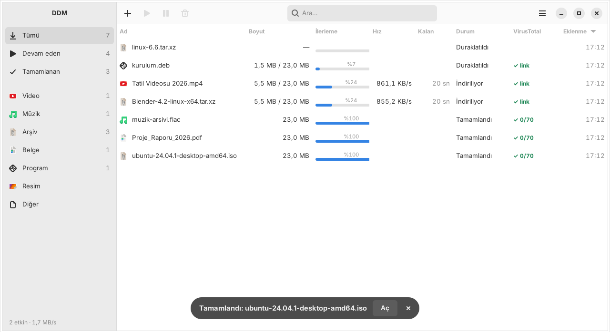
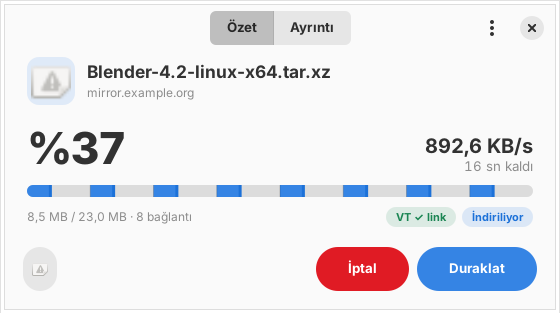
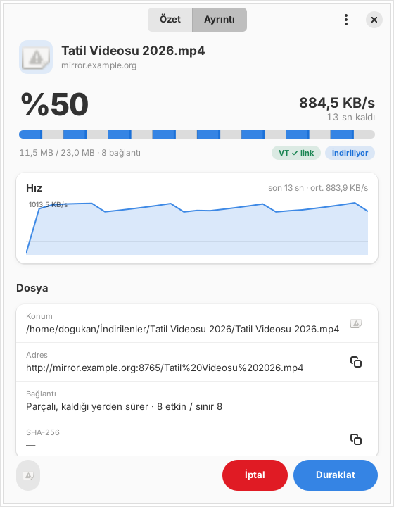
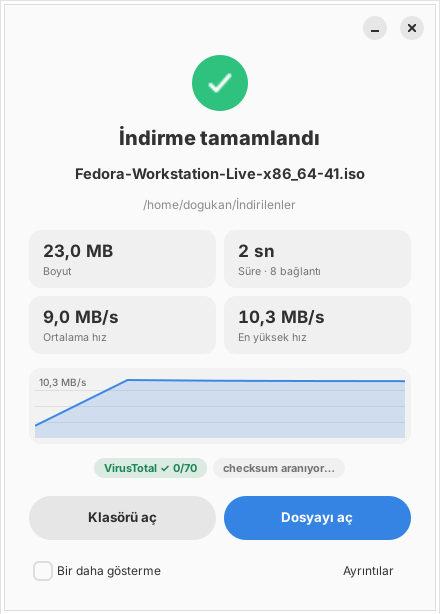
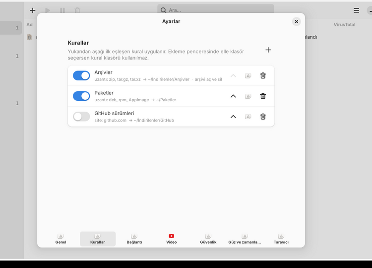
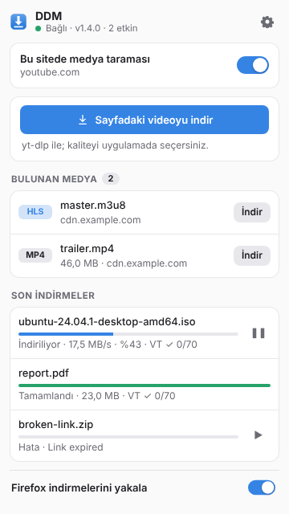

# DoDownloadManager (DDM)

[English](README.md) · **Türkçe**

Ubuntu için çok bağlantılı indirme yöneticisi. GTK4/libadwaita arayüzü, IDM tarzı dinamik parça bölme, birden fazla internet bağlantısını birleştirme, yt-dlp ile video indirme, VirusTotal kontrolü ve Firefox entegrasyonu.

Arayüz **Türkçe** ve **İngilizce**. Varsayılan olarak sistem dilini izler; Ayarlar ▸ Genel ▸ Dil bölümünden değiştirilebilir.



| Özet | Ayrıntı | Bitiş |
|---|---|---|
|  |  |  |

## Özellikler

**İndirme motoru**
- Dosyayı HTTP `Range` istekleriyle 1–16 paralel bağlantıya böler (varsayılan 8).
- **Dinamik bölme:** Biten bağlantı, en çok işi kalan parçanın yarısını devralır. Bu sayede sona doğru tek yavaş bağlantı beklenmez.
- Parça durumu her 2 saniyede SQLite'a yazılır. Uygulama kapanıp açılsa da indirme kaldığı yerden sürer. `ETag` veya `Last-Modified` değişmişse indirme baştan başlar.
- Sunucu 429/503 dönerse bağlantı sayısı otomatik azaltılır, sunucu sakinleşince kademeli olarak geri artırılır. `Retry-After` başlığına uyulur.
- Range desteği olmayan sunucularda tek bağlantıya düşer. İndirme ortasında Range'i reddeden sunucuyu da yakalar.
- Süresi dolmuş yönlendirme linkleri (403/410) için orijinal adresten yeniden çözümleme yapar.
- Genel hız sınırı (token bucket), eşzamanlı indirme sınırı ve sıralı kuyruk.
- Disk alanı dosya boyutunda önceden ayrılır (`posix_fallocate`). Diskte yer yoksa indirme başlamadan uyarır.

**Çoklu bağdaştırıcı (bağlantı birleştirme)**
- Büyük dosyaların bağlantıları birden fazla internet hattına dağıtılır. Örneğin ev Wi-Fi'si ile telefondan USB internet paylaşımı birlikte kullanılabilir.
- Her bağlantı `SO_BINDTODEVICE` ile ilgili ağ kartına bağlanır. Linux 5.7 ve üstünde root yetkisi gerekmez.
- Hızlı hat daha çok parça alır. Bir hat koparsa ya da 6 saniye boyunca veri gelmezse o hattın parçaları diğer hatta devredilir ve indirme kesilmez.
- Ayarlar ▸ Bağlantı ▸ *Çoklu bağdaştırıcı* bölümünden açılır. Hangi hatların kullanılacağı ve en küçük dosya boyutu (varsayılan 50 MB) seçilebilir. Ölçülü (kotalı) bağlantılar işaretlenir.
- Ayrıntı penceresinde her hattın anlık hızı görünür.
- Sınırlar: Aynı modeme bağlı Wi-Fi ve kablo hız kazandırmaz, çünkü ikisi aynı internet hattını paylaşır. Range desteklemeyen sunucularda ve yt-dlp videolarında kullanılmaz.

**Süresi dolan link yenileme**
- Sunucu 401/403/404/410 dönerse ve indirmenin bir kısmı inmişse indirme "Link süresi doldu" olarak işaretlenir. Yarım dosya silinmez.
- İndirme sayfasını yeniden açıp tarayıcıda indir'e basarsan DDM aynı dosyayı adından ve boyutundan tanır ve "Kaldığı yerden sürdür" önerir. Aynı öneri ekleme penceresinde de çıkar. Sağ tık ▸ *Linki yenile…* ile yeni linki elle de yapıştırabilirsin.
- Devam etmeden önce yeni linkin aynı dosyayı verdiği doğrulanır: boyut aynı olmalı ve inmiş bir bölgeden alınan örnek baytlar eşleşmeli. Tutmazsa yarım dosya korunur ve uyarı verilir.

**Güç ve zamanlama**
- İndirme sürerken bilgisayar uykuya geçmez. Ekran yine kararabilir.
- Ana menü ▸ *Tümü bitince* ▸ *Uyku moduna geç / Bilgisayarı kapat*. Tek seferliktir ve 60 saniyelik geri sayımla iptal edilebilir.
- **Zamanlayıcı:** Ekleme penceresinde ya da sağ tık menüsünde *Zamanla* denilen indirmeler sadece belirlenen saatlerde çalışır (varsayılan 02:00–07:00, gece yarısını aşan aralıklar da olur). Aralık bitince durur, ertesi gün devam eder.
- **Ölçülü bağlantı:** Telefondan internet paylaşımı gibi kotalı bağlantılarda indirmeler bekletilir ya da hızları sınırlanır. Bildirimdeki *Yine de indir* düğmesiyle o bağlantı için geçilebilir.

**Kurallar ve otomatik işlemler**



- Ayarlar ▸ Kurallar: uzantı, site ve dosya adında geçen ifade koşullarına göre klasör belirlenir. Örneğin `deb, rpm` → `~/Paketler`, `github.com` → `~/İndirilenler/GitHub`.
- Kural seçenekleri: arşivi otomatik aç (zip, tar.gz/xz/bz2; 7z, rar ve zst için `7zip` paketi gerekir), açtıktan sonra arşivi sil, bitince dosyayı ya da açılan klasörü aç.
- Arşiv tek bir klasör içeriyorsa iç içe klasör oluşturulmaz. Arşivden dışarı yazmaya çalışan güvensiz yollar reddedilir.
- VirusTotal zararlı derse ya da checksum tutmazsa otomatik işlem yapılmaz.

**Checksum doğrulama**
- İndirme bitince aynı dizinde `SHA256SUMS`, `dosya.sha256` gibi checksum dosyaları aranır. Bulunursa dosya otomatik doğrulanır. Ubuntu ISO'ları ve GitHub sürümlerinin çoğunda bu dosyalar var.
- Sonuç bitiş penceresinde ve ayrıntı penceresinde görünür. Uyuşmazsa uyarı verilir ve listede "≠ hash" etiketi çıkar.

**Video**
- YouTube, Vimeo, X, Instagram ve yt-dlp'nin desteklediği diğer siteler, ayrıca doğrudan `.m3u8`/`.mpd` akışları.
- Kalite seçimi (sayfadaki gerçek çözünürlükler listelenir), MP4/MKV, yalnız ses (MP3/M4A).
- **Kendi klasörüne indirme:** Her video kendi klasörüne kaydedilir (`Video Adı/Video Adı.mp4`). Doğrudan inen `.mp4` ve `.mkv` dosyaları için de geçerlidir, yalnız ses indirmeleri klasöre konmaz. Ayarlar ▸ Video bölümünden kapatılabilir, ekleme penceresinden indirme bazında değiştirilebilir. İptal edilen indirmenin boş kalan klasörü silinir.
- HLS/DASH parçaları paralel indirilir. Görüntü ve ses ffmpeg ile birleştirilir.
- Tarayıcı çerezleri yt-dlp'ye aktarılır, böylece giriş gerektiren videolar da indirilebilir.
- yt-dlp, Ayarlar ▸ Video bölümünden tek tıkla güncellenir.
- DRM korumalı içerik (Netflix, Disney+ vb.) indirilemez.

**Arayüz**
- Türkçe ve İngilizce. Varsayılan olarak sistem dili kullanılır. Ayarlar ▸ Genel ▸ Dil bölümünden değiştirilince uygulama yeniden başlar, indirmeler kaldığı yerden sürer.
- Kategoriler (Video, Müzik, Arşiv, Belge, Program, Resim), arama ve sıralanabilir tablo.
- Ayrıntı penceresinin iki görünümü var ve son seçilen hatırlanır:
  - **Özet:** büyük yüzde, hız, kalan süre, parça çubuğu, durum ve VirusTotal etiketleri.
  - **Ayrıntı:** son 60 saniyenin hız grafiği, konum, adres, SHA-256, VirusTotal sonuçları ve bağlantı başına ilerleme çubukları.
- İndirme bitince özet penceresi açılır: boyut, süre, ortalama ve en yüksek hız, indirme boyunca hız grafiği, VirusTotal sonucu, *Dosyayı aç* ve *Klasörü aç*. Ayarlar ▸ Genel bölümünden kapatılabilir.
- Bildirimler, DDM penceresine geçince ya da ilgili dosya açılınca/silinince GNOME bildirim listesinden kendiliğinden kalkar.
- `Ctrl+V` ile yapıştırma, pencereye link sürükleme, pencere öne geldiğinde panodaki linki önerme.
- Pencere kapanınca arka planda çalışmaya devam eder. Bildirime tıklayınca dosya açılır.
- **Üst çubuk simgesi:** Ubuntu'nun hazır gelen AppIndicator desteğiyle görünür.

  

  - İndirme sürerken simge, toplam ilerlemeyi gösteren bir halkaya dönüşür. Yanında yüzde ve hız yazar (`%42 · 12,4 MB/s`).
  - Menüde özet satırı, her indirme için metin ilerleme çubuğu (`▰▰▰▰▱▱▱▱▱▱ %42`) ve son tamamlananlar bulunur.
  - Sol tık pencereyi açar, orta tık yeni indirme penceresini açar.
  - Sağ tık menüsünde etkin indirmeler (yüzde ve hızıyla; tıklanınca ayrıntı penceresi), *Tümünü duraklat / sürdür*, *Ayarlar* ve *Çık* bulunur.
  - Ayarlar ▸ Genel bölümünden kapatılabilir ya da yalnızca hız etiketi gizlenebilir.
  - Ubuntu dışı GNOME dağıtımlarında "AppIndicator and KStatusNotifierItem Support" eklentisi gerekir.
- İsteğe bağlı: oturum açılınca başlatma, indirmeleri kategori klasörlerine ayırma.

**VirusTotal**
- Ayarlar ▸ Güvenlik bölümüne ücretsiz VirusTotal API anahtarı girildiğinde her indirme kontrol edilir. Dosyanın kendisi gönderilmez.
- **Başlarken:** Link adresi, link kayıtlı değilse alan adı sorgulanır. Zararlı işaretliyse indirme duraklatılır ve "İptal / VirusTotal'da gör / Yine de indir" diye sorulur. Link kontrolleri kuyrukta öne alınır, alan adı sonuçları 6 saat önbellekte tutulur.
- **İndirme sırasında:** Sunucu yanıt başlıklarında hash veriyorsa (`Repr-Digest`, `Digest`, `x-goog-hash`, `x-amz-checksum-sha256`) o hash dosya inmeden sorgulanır.
- **Bitince:** SHA-256 hesaplanır ve sorgulanır. Sonuç listedeki VirusTotal sütununda görünür: ✓ 0/70, ⚠ 2/70, ✕ 15/70 ya da "? kayıtsız". Zararlı dosya için bildirim gelir ve dosya açılmadan önce onay istenir.
- **Bütünlük kontrolü:** Sunucunun bildirdiği hash ile inen dosyanınki uyuşmazsa "≠ hash" uyarısı çıkar. SHA-256, API anahtarı olmasa da her zaman hesaplanır ve ayrıntı penceresinde gösterilir.
- **Kayıtsız dosyalar:** Sağ tık ▸ *VirusTotal'a yükle ve tara* ile gönderilebilir (onay sorulur, 650 MB sınırı vardır). Yüklenen dosyalar VirusTotal'ın ortaklarıyla paylaşıldığı için kişisel belgeleri yüklemeyin.
- **Ücretsiz kota:** Dakikada 4, günde 500 sorgu. Bir indirme en fazla 3 sorgu harcar. Aynı anda çok indirme başlarsa sonuçlar sırayla, birkaç dakika içinde gelir. Bu yüzden çok hızlı biten bir indirmede link uyarısı dosya indikten sonra gelebilir; bitişteki dosya kontrolü yine yapılır.

**Firefox eklentisi**



- Firefox'ta başlayan indirmeleri (uzantı listesine göre) çerez, Referer ve User-Agent bilgisiyle birlikte DDM'ye devreder. Uygulama kapalıysa indirme Firefox'ta kalır.
- Firefox'un dilini izler (Türkçe ya da İngilizce).
- **Erken yakalama (1.0.2):** İndirme, sunucunun yanıt başlıkları geldiği anda yakalanır (`webRequest`). Firefox dosyayı indirmeye hiç başlamaz. Böylece birkaç MB'lık küçük `.tar.gz` gibi dosyalar da kaçmaz. Yakalanamayan durumlar için eski yöntem (indirme başladıktan sonra iptal) yedek olarak çalışır.
- **Site bazlı medya taraması:** Yalnızca açtığınız sitelerde çalışır. Ağ trafiğindeki video/ses dosyalarını ve HLS/DASH akışlarını yakalar, araç çubuğu rozetinde sayısını gösterir.
- Video üstünde "İndir" düğmesi (ayarlardan kapatılabilir).
- Sağ tık menüsü: *DDM ile indir* (link), *Bu medyayı indir* (video/ses), *Sayfadaki videoyu indir*.
- Popup: bağlantı durumu, bulunan medya, son indirmeler ve duraklat/sürdür.

## Kurulum

Gereksinim: Ubuntu 24.04 veya üstü (GTK 4.12+, libadwaita 1.5+).

```bash
git clone https://github.com/ddogukann/DoDownloadManager.git
cd DoDownloadManager
./install.sh
```

Betik şunları yapar:
- Eksik paketleri `apt` ile kurar: `python3-gi`, `python3-gi-cairo`, `gir1.2-gtk-4.0`, `gir1.2-adw-1`, `python3-requests`, `ffmpeg`.
- Uygulamayı `~/.local/share/ddm/app` altına kopyalar.
- `~/.local/bin/ddm` başlatıcısını ve masaüstü girdisini oluşturur.
- yt-dlp'nin güncel sürümünü indirir.
- Eklentiyi `~/.local/share/ddm/extension/ddm-firefox.xpi` olarak paketler.

Seçenekler: `--no-apt` (paket kurulumunu atla), `--no-ytdlp`.

Kaldırmak için `./uninstall.sh` kullanın. Ayarları ve geçmişi de silmek için `--purge` ekleyin. İndirilen dosyalara dokunulmaz.

## Firefox eklentisi

Firefox'un kararlı sürümü yalnızca Mozilla tarafından imzalanmış eklentileri kalıcı olarak kurar. Üç yol var:

1. **İmzalatmak (önerilen, ücretsiz):** [AMO API anahtarı](https://addons.mozilla.org/developers/addon/api/key/) alın ve şunu çalıştırın:
   ```bash
   export AMO_JWT_ISSUER="user:…"  AMO_JWT_SECRET="…"
   ./scripts/sign-extension.sh
   ```
   Eklenti "unlisted" kanalda imzalanır; mağazada görünmez. `dist/` altındaki `.xpi` dosyasını Firefox'a sürükleyip bırakmanız yeterli.
   Eklentinin her yeni sürümü (`manifest.json` içindeki `version`) yeniden imzalanmalıdır. Aynı sürüm numarası ikinci kez imzalanamaz.
2. **Geçici yükleme:** `about:debugging#/runtime/this-firefox` ▸ *Geçici Eklenti Yükle* ▸ `extension/manifest.json`. Firefox kapanınca eklenti kaldırılır, geliştirme ve deneme için uygundur.
3. **Developer Edition / Nightly:** `about:config` içinde `xpinstall.signatures.required = false` ayarlayıp `.xpi` dosyasını doğrudan kurabilirsiniz.

Ubuntu'daki snap Firefox ile sorunsuz çalışır. Eklenti uygulamaya native messaging yerine `127.0.0.1` üzerinden bağlandığı için snap kısıtlamalarına takılmaz.

Kurulumdan sonra eklentiyi kullanmak için:
- Medya taraması istediğiniz sitede araç çubuğundaki DDM simgesine tıklayın ve **Bu sitede medya taraması** anahtarını açın.
- Hangi dosya uzantılarının yakalanacağını ve en küçük boyutu DDM ▸ Ayarlar ▸ Tarayıcı bölümünden belirleyin.

## Çeviri

Uygulama metinleri `ddm/locale/<dil>.po` dosyalarında durur (standart gettext biçimi; Poedit ya da herhangi bir metin düzenleyiciyle düzenlenebilir). Kaynak dil Türkçe'dir. Eklenti metinleri `extension/_locales/<dil>/messages.json` dosyalarındadır.

```bash
python3 scripts/i18n.py check en    # çevrilmemiş ya da kullanılmayan metinleri listeler
python3 scripts/i18n.py update en   # yeni metinleri boş çeviriyle ekler
```

Yeni bir dil eklemek için `ddm/locale/en.po` dosyasını `ddm/locale/<kod>.po` olarak kopyalayıp çevirin ve kodu `ddm/i18n.py` içindeki `LANGUAGES` listesine ekleyin.

## Komut satırı

```bash
ddm                          # pencereyi aç
ddm https://…/dosya.iso      # onay penceresiyle ekle
ddm --now URL1 URL2          # doğrudan kuyruğa ekle
ddm --video https://youtu.be/…
ddm --background             # pencere açmadan başlat
ddm --quit
```

Uygulama zaten çalışıyorsa komutlar mevcut örneğe iletilir.

## Mimari

```
Firefox eklentisi ──HTTP (127.0.0.1:47821)──┐
                                            ▼
ddm (tek süreç, GTK4 ana döngüsü)
 ├─ bridge.py     localhost köprüsü (Origin/Host denetimi)
 ├─ manager.py    kuyruk, eşzamanlılık, olaylar, SQLite kalıcılığı
 ├─ engine.py     segmentli HTTP motoru (thread başına bağlantı, os.pwrite)
 ├─ netlanes.py   çoklu bağdaştırıcı (SO_BINDTODEVICE, hat keşfi)
 ├─ video.py      yt-dlp alt süreci (ilerleme ayrıştırma, çerez dosyası)
 ├─ tray.py       üst çubuk simgesi (StatusNotifierItem + dbusmenu, D-Bus)
 ├─ virustotal.py link, alan adı ve hash sorgusu; yükle-tara (öncelikli kuyruk, 4 sorgu/dk)
 ├─ post.py       checksum dosyası bulma, arşiv açma, kural sonrası işlemler
 └─ ui/           ana pencere, ekleme diyaloğu, ayrıntı penceresi, ayarlar
```

| Yol | İçerik |
|---|---|
| `~/.config/ddm/settings.json` | ayarlar |
| `~/.config/ddm/token` | CLI ve yerel betikler için köprü anahtarı (0600) |
| `~/.local/share/ddm/downloads.db` | indirme geçmişi ve parça durumu |
| `~/.local/share/ddm/bin/yt-dlp` | uygulamanın yönettiği yt-dlp |

### Köprü API'si

| Uç nokta | Açıklama |
|---|---|
| `GET /ping` | sürüm, yt-dlp durumu, etkin sayısı, yakalama ayarları |
| `POST /download` | `{url, kind: "file"\|"video", filename?, referer?, userAgent?, cookieHeader?, cookies?[], pageUrl?, title?}` |
| `GET /downloads` | son 50 indirme ve canlı ilerleme |
| `POST /action` | `{id, action: "pause"\|"resume"\|"cancel"}` |

Köprü yalnızca `127.0.0.1` adresinde dinler. Kabul edilen istekler:
- `Origin` başlığı yoksa ya da `moz-extension://` ise,
- ve `Host` başlığı `127.0.0.1` veya `localhost` ise (DNS rebinding'e karşı),
- ve istek `X-DDM-Client` başlığını ya da doğru `X-DDM-Token` değerini taşıyorsa.

Sıradan web sayfaları bu başlıkları CORS ön kontrolü olmadan gönderemez, ön kontrole de yalnızca eklenti kaynaklarına yanıt verilir.

Kendi betiğinizden indirme eklemek için:

```bash
curl -H "X-DDM-Token: $(cat ~/.config/ddm/token)" \
     -H "Content-Type: application/json" \
     -d '{"url":"https://example.com/dosya.zip"}' http://127.0.0.1:47821/download
```

## Gizlilik

- DDM hiçbir veriyi geliştiriciye göndermez; telemetri yoktur.
- VirusTotal açıksa indirilen dosyanın SHA-256 değeri, indirme linki ve alan adı VirusTotal'a gönderilir. Dosyanın kendisi yalnızca *VirusTotal'a yükle ve tara* seçildiğinde, onay alınarak yüklenir.
- Checksum doğrulaması için dosyanın indiği sunucudan `SHA256SUMS` gibi küçük dosyalar istenir.
- API anahtarı ve ayarlar yalnızca `~/.config/ddm/` içinde, sadece sizin okuyabileceğiniz izinlerle saklanır.

## Notlar

- GNOME Wayland'de uygulamalar arka plandayken panoyu okuyamaz. Pano önerisi bu yüzden pencere öne geldiğinde çalışır.
- Yalnızca indirme hakkınız olan içerikleri indirin. YouTube gibi platformlarda indirme, kendi videolarınız ya da açık lisanslı içerik dışında kullanım şartlarına aykırı olabilir.

## Lisans

[MIT](LICENSE). Ücretsizdir; kullanabilir, değiştirebilir ve dağıtabilirsiniz, yeter ki lisans metni korunsun.

Üçüncü taraf bileşenler pakete dahil değildir:
- [yt-dlp](https://github.com/yt-dlp/yt-dlp) (Unlicense) kurulumda ve güncellemede resmi sürüm sayfasından indirilir.
- [FFmpeg](https://ffmpeg.org) (LGPL/GPL) Ubuntu paket deposundan kurulur.
- GTK, libadwaita ve PyGObject (LGPL) ile [requests](https://github.com/psf/requests) (Apache 2.0) sistem paketleri olarak kullanılır.
